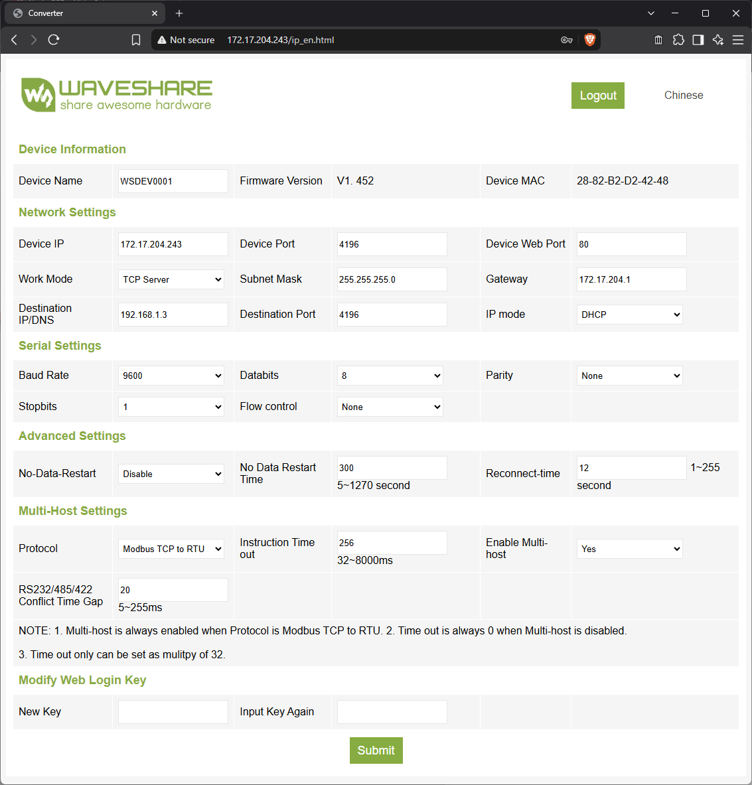
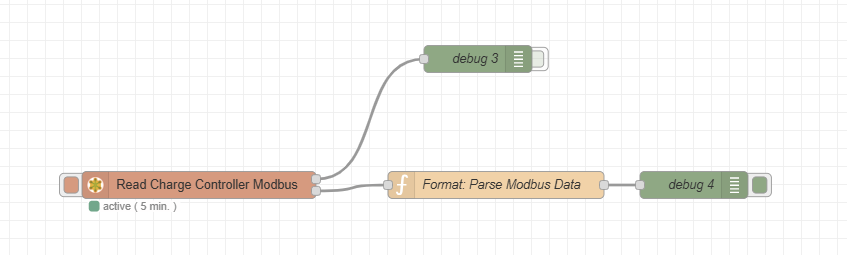
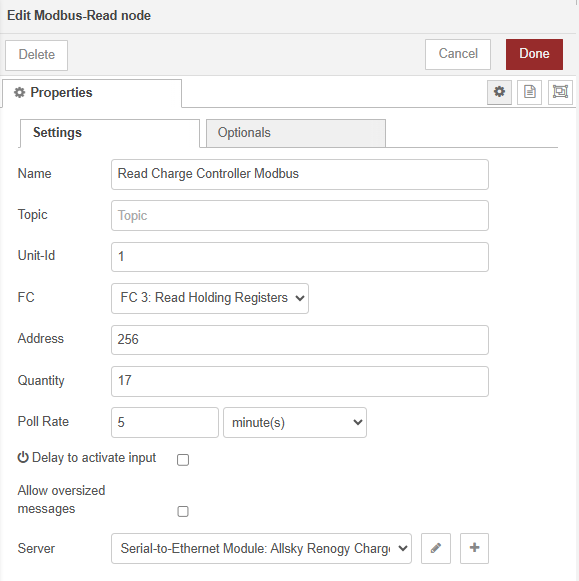
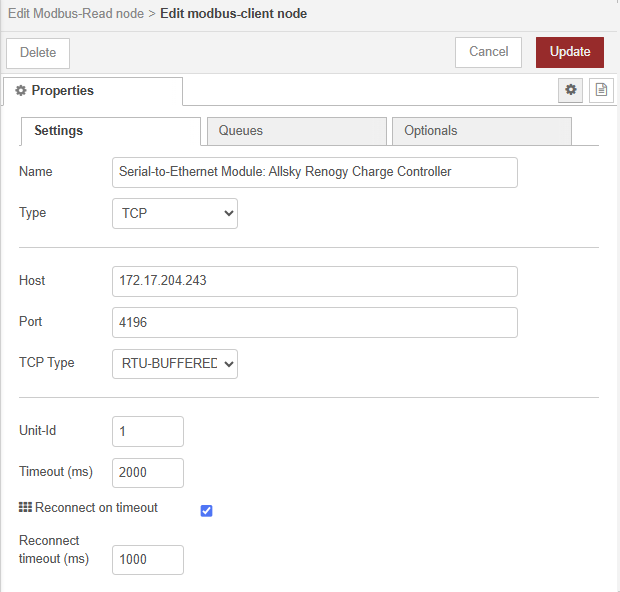
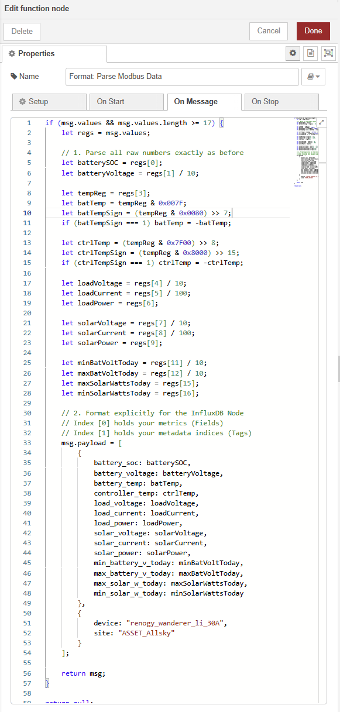

# NodeRED Configuration

After confirming the operation using the testing the procedure shown in [RENOGY_RJ12_PINOUT.md](RENOGY_RJ12_PINOUT.md), this document was made to show the configuration in NodeRED.

## WaveShare Configuration

Slight modifications had to made to work with the Modbus-Read Nodes.

- Enable Multi-host: *Yes*
- Protocol: *Modbus TCP to RTU*



## NodeREDs nodes and flow



A Modbus-Read node is used to query modbus data from the charge controller over a network.

A function node is used to parse the data into a NodeRED message, that can be used in later nodes.







```javascript
if (msg.values && msg.values.length >= 17) {
    let regs = msg.values;

    // 1. Parse all raw numbers exactly as before
    let batterySOC = regs[0];
    let batteryVoltage = regs[1] / 10;

    let tempReg = regs[3];
    let batTemp = tempReg & 0x007F;
    let batTempSign = (tempReg & 0x0080) >> 7;
    if (batTempSign === 1) batTemp = -batTemp;

    let ctrlTemp = (tempReg & 0x7F00) >> 8;
    let ctrlTempSign = (tempReg & 0x8000) >> 15;
    if (ctrlTempSign === 1) ctrlTemp = -ctrlTemp;

    let loadVoltage = regs[4] / 10;
    let loadCurrent = regs[5] / 100;
    let loadPower = regs[6];

    let solarVoltage = regs[7] / 10;
    let solarCurrent = regs[8] / 100;
    let solarPower = regs[9];

    let minBatVoltToday = regs[11] / 10;
    let maxBatVoltToday = regs[12] / 10;
    let maxSolarWattsToday = regs[15];
    let minSolarWattsToday = regs[16];

    // 2. Format explicitly for the InfluxDB Node
    // Index [0] holds your metrics (Fields)
    // Index [1] holds your metadata indices (Tags)
    msg.payload = [
        {
            battery_soc: batterySOC,
            battery_voltage: batteryVoltage,
            battery_temp: batTemp,
            controller_temp: ctrlTemp,
            load_voltage: loadVoltage,
            load_current: loadCurrent,
            load_power: loadPower,
            solar_voltage: solarVoltage,
            solar_current: solarCurrent,
            solar_power: solarPower,
            min_battery_v_today: minBatVoltToday,
            max_battery_v_today: maxBatVoltToday,
            max_solar_w_today: maxSolarWattsToday,
            min_solar_w_today: minSolarWattsToday
        },
        {
            device: "renogy_wanderer_li_30A",
            site: "ASSET_Allsky"
        }
    ];

    return msg;
}

return null;
```