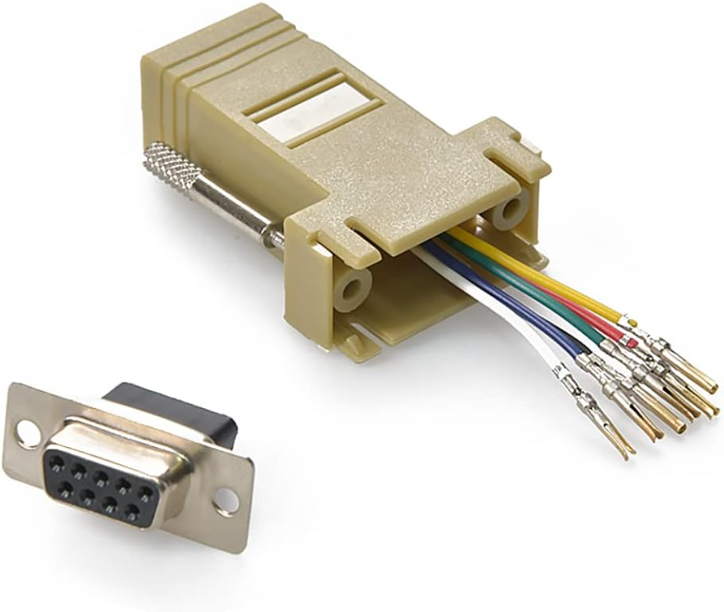
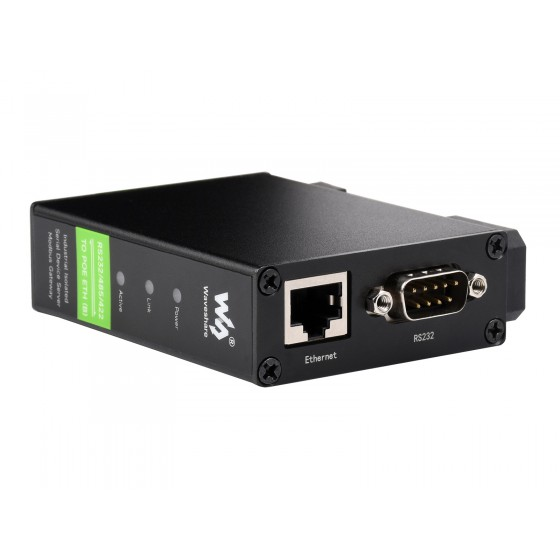
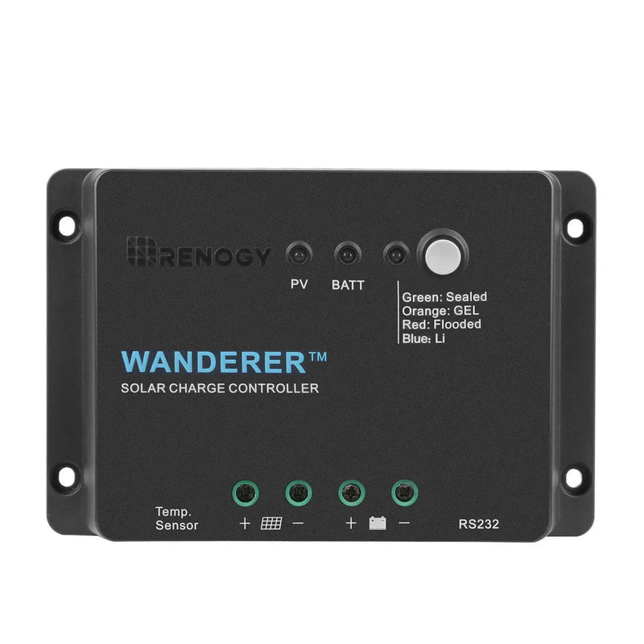
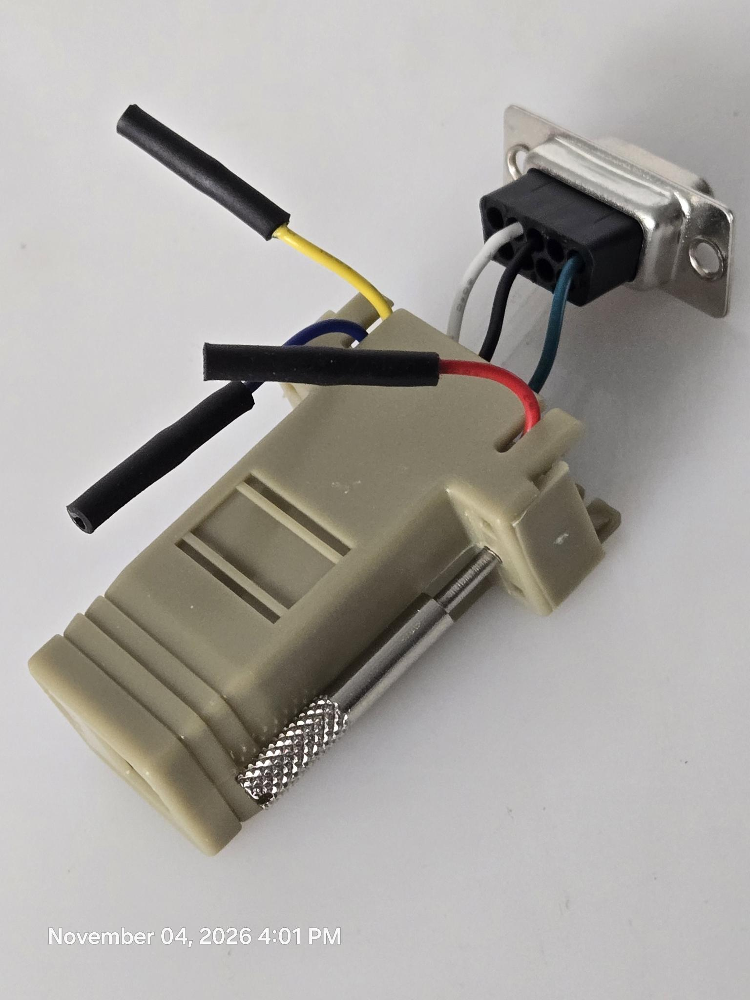
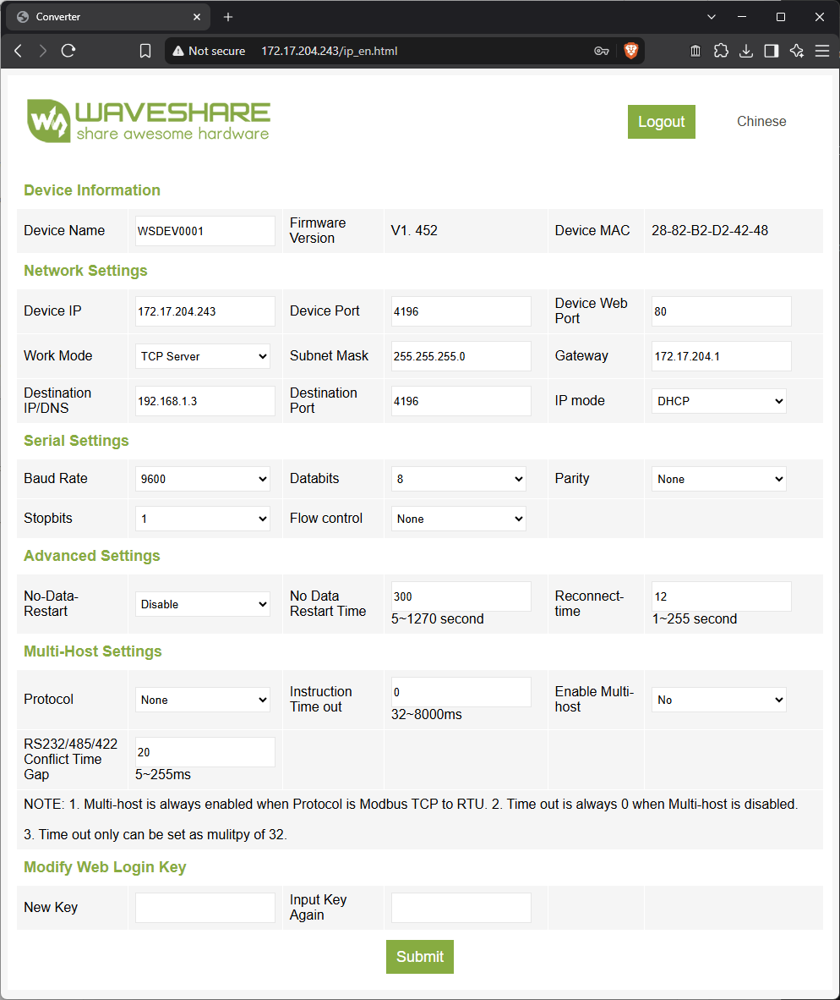

# Renogy RJ12 Pinout

**Hardware used:** 

- DB9 Female to RJ11/12 (6 Wire) Modular Adapter Ivory – Gold Plated
    - [https://www.amazon.com/dp/B06X9ZJB5R/](https://www.amazon.com/dp/B06X9ZJB5R/)



- WaveShare RS232/485/422 TO POE ETH (B)
    - [https://www.amazon.com/dp/B0BN61G4VF/](https://www.amazon.com/dp/B0BN61G4VF/)
    - [https://www.waveshare.com/wiki/RS232/485/422_TO_POE_ETH_(B)](https://www.waveshare.com/wiki/RS232/485/422_TO_POE_ETH_(B))



- Renogy Wanderer Li 30A PWM Charge Controller
    - [https://www.renogy.com/products/wanderer-li-30a-pwm-charge-controller](https://www.renogy.com/products/wanderer-li-30a-pwm-charge-controller)



## DMM Testing Table

Testing was done with the DB9-RJ12 adapter hooked up to a [Renogy Wanderer Li 30A PWM Charge Controller](https://www.renogy.com/products/wanderer-li-30a-pwm-charge-controller) via a RJ12 cable. The battery leads of the charge controller was hooked up to a charged battery. A multimeter (DMM) was used to measure all possible DC voltage differences between each color combination.

<table>
    <thead>
        <th style="background-color: black; color: white; font-weight: bold;">DMM</th>
        <th style="background-color: black; color: white; font-weight: bold;">Black</th>
        <th style="background-color: black; color: white; font-weight: bold;" colspan=6>Red</th>
    </thead>
    <tbody>
        <tr>
            <td style="background-color: black; color: white; font-weight: bold;"></td>
            <td style="background-color: grey; color: white; font-weight: bold;">Color</td>
            <td style="background-color: red; color: white; font-weight: bold;">Red</td>
            <td style="background-color: green; color: white; font-weight: bold;">Green</td>
            <td style="background-color: white; color: black; font-weight: bold;">White</td>
            <td style="background-color: black; color: white; font-weight: bold;">Black</td>
            <td style="background-color: blue; color: white; font-weight: bold;">Blue</td>
            <td style="background-color: yellow; color: black; font-weight: bold;">Yellow</td>
        </tr>
        <tr>
            <td style="background-color: black; color: white; font-weight: bold;" rowspan=6>Voltage</td>
            <td style="background-color: red; color: white; font-weight: bold;">Red</td>
            <td bgcolor=grey></td>
            <td>0</td>
            <td>-5.78</td>
            <td>0</td>
            <td>12.63</td>
            <td>12.63</td>
        </tr>
        <tr>
            <td style="background-color: green; color: white; font-weight: bold;">Green</td>
            <td>0</td>
            <td bgcolor=grey></td>
            <td>-5.78</td>
            <td>0</td>
            <td>12.63</td>
            <td>12.63</td>
        </tr>
        <tr>
            <td style="background-color: white; color: black; font-weight: bold;">White</td>
            <td>5.78</td>
            <td>5.78</td>
            <td bgcolor=grey></td>
            <td>5.70</td>
            <td>18.37</td>
            <td>18.37</td>
        </tr>
        <tr>
            <td style="background-color: black; color: white; font-weight: bold;">Black</td>
            <td>0</td>
            <td>0</td>
            <td>-5.72</td>
            <td bgcolor=grey></td>
            <td>12.48</td>
            <td>12.41</td>
        </tr>
        <tr>
            <td style="background-color: blue; color: white; font-weight: bold;">Blue</td>
            <td>-12.59</td>
            <td>-12.59</td>
            <td>-18.38</td>
            <td>-12.33</td>
            <td bgcolor=grey></td>
            <td>0</td>
        </tr>
        <tr>
            <td style="background-color: yellow; color: black; font-weight: bold;">Yellow</td>
            <td>-12.61</td>
            <td>-12.61</td>
            <td>-18.38</td>
            <td>-12.45</td>
            <td>0</td>
            <td bgcolor=grey></td>
        </tr>
    </tbody>
</table>

## Wire Identification

Readings above are the red probe minus the black probe, so each row is a reference wire.

<table>
    <thead>
        <th style="background-color: grey; color: white; font-weight: bold;">Wire</th>
        <th style="background-color: grey; color: white; font-weight: bold;">Voltage relative to Red</th>
        <th style="background-color: grey; color: white; font-weight: bold;">Function</th>
    </thead>
    <tbody>
        <tr>
            <td style="background-color: red; color: white; font-weight: bold;">Red</td>
            <td>0</td>
            <td>GND</td>
        </tr>
        <tr>
            <td style="background-color: green; color: white; font-weight: bold;">Green</td>
            <td>0 (same as Red in every row)</td>
            <td>GND</td>
        </tr>
        <tr>
            <td style="background-color: black; color: white; font-weight: bold;">Black</td>
            <td>~0V (drifts slightly, undriven input)</td>
            <td>RX (controller input)</td>
        </tr>
        <tr>
            <td style="background-color: white; color: black; font-weight: bold;">White</td>
            <td>-5.78</td>
            <td>TX (controller output, RS-232 idle level)</td>
        </tr>
        <tr>
            <td style="background-color: blue; color: white; font-weight: bold;">Blue</td>
            <td>+12.6</td>
            <td>Power (do not connect)</td>
        </tr>
        <tr>
            <td style="background-color: yellow; color: black; font-weight: bold;">Yellow</td>
            <td>+12.6</td>
            <td>Power (do not connect)</td>
        </tr>
    </tbody>
</table>

## DB9 Wiring (RS-232)

Pin numbers are for a standard DB9 serial port (DTE, such as a PC COM port), where pin 2 is RXD and pin 3 is TXD. Controller TX goes to the converter's RXD, and controller RX goes to the converter's TXD.

<table>
    <thead>
        <tr>
            <th style="background-color: grey; color: white; font-weight: bold;">Wire color</th>
            <th style="background-color: grey; color: white; font-weight: bold;">Controller function</th>
            <th style="background-color: grey; color: white; font-weight: bold;">DB9 pin</th>
            <th style="background-color: grey; color: white; font-weight: bold;">DB9 function</th>
        </tr>
    </thead>
    <tbody>
        <tr>
            <td style="background-color: white; color: black; font-weight: bold;">White</td>
            <td>TX</td>
            <td>2</td>
            <td>RXD</td>
        </tr>
        <tr>
            <td style="background-color: black; color: white; font-weight: bold;">Black</td>
            <td>RX</td>
            <td>3</td>
            <td>TXD</td>
        </tr>
        <tr>
            <td style="background-color: red; color: white; font-weight: bold;">Red (or Green)</td>
            <td>GND</td>
            <td>5</td>
            <td>GND</td>
        </tr>
        <tr>
            <td style="background-color: green; color: white; font-weight: bold;">Green (or Red)</td>
            <td>GND</td>
            <td>not used</td>
            <td></td>
        </tr>
        <tr>
            <td style="background-color: blue; color: white; font-weight: bold;">Blue</td>
            <td>Power +12.6 V</td>
            <td>not used</td>
            <td>insulate</td>
        </tr>
        <tr>
            <td style="background-color: yellow; color: black; font-weight: bold;">Yellow</td>
            <td>Power +12.6 V</td>
            <td>not used</td>
            <td>insulate</td>
        </tr>
    </tbody>
</table>



Unused wires are wrapped in adhesive lined shrink tubing to insulate

# Testing

The `main.py` script was used to test the wiring

``` powershell
PS C:\Users\Trey\source\repos\renogymodbus> uv run .\main.py --host 172.17.204.243
Modbus RTU test passed: 172.17.204.243:4196, slave 1
Battery voltage: 13.1 V
```

Output confirms the system and wiring is working.

## WaveShare Serial-to-Ethernet Converter Configuration


